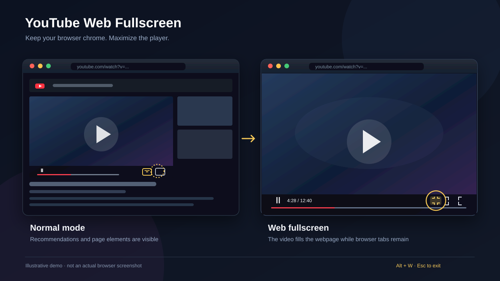

# YouTube Web Fullscreen

 

**让 YouTube 视频充满当前浏览器的网页区域，同时保留标签栏和地址栏。** 这不是系统全屏，也不是 YouTube 的影院模式。

> 图片为界面示意图，并非实际浏览器截图。当前版本主要针对 YouTube 桌面版视频页设计。

## 安装教程（推荐：Tampermonkey／油猴）

**第一步：安装油猴扩展。** 在浏览器中安装 [Tampermonkey（篡改猴）](https://www.tampermonkey.net/) 并启用。如果你使用的是其他兼容用户脚本管理器，也可以尝试安装。

**第二步：安装脚本。** 选择下面任一方式：

- **直接安装：** 打开 [YouTube Web Fullscreen 脚本原始地址](https://raw.githubusercontent.com/xke123/YouTube-Web-FullScreen/main/YouTube-Web-Fullscreen.user.js)。如果管理器支持识别 `.user.js`，按提示安装。
- **手动安装（通用）：** 点击油猴扩展图标 → **管理面板** → **添加新脚本**；删除编辑器中原有的示例代码，打开仓库中的 [YouTube-Web-Fullscreen.user.js](./YouTube-Web-Fullscreen.user.js)，复制**完整源码**粘贴进去，再保存（通常是 `Ctrl + S` 或 `⌘ + S`）。

**第三步：启用并使用。** 在油猴管理面板确认脚本处于启用状态，进入 [YouTube](https://www.youtube.com/) 的普通视频播放页并**完整刷新**。将鼠标移入视频区域，播放器底部右侧会出现新增的「网页全屏」按钮（通常在 YouTube 自带全屏按钮旁边）。

> **升级提示：** 如果曾安装旧版，请先停用或删除重复的同名脚本，避免多个版本同时操作播放器。

## 如何使用

| 操作 | 效果 |
| --- | --- |
| 点击播放器右下角新增按钮 | 进入／退出网页全屏 |
| `Alt + W` | 切换网页全屏 |
| `Esc` | 退出网页全屏 |
| 点击 YouTube 原有全屏按钮 | 使用浏览器／系统原生全屏 |

网页全屏时，视频覆盖当前浏览器的**内容区**，YouTube 页面中的导航、推荐等元素被暂时隐藏，但浏览器标签栏与地址栏保持不变；退出时恢复原页面布局。

## Safari 用户：Userscripts 备选方案

如果你在 Safari 中未使用 Tampermonkey，可以改用 [Userscripts for Safari](https://github.com/quoid/userscripts)：

1. 安装并启用 Userscripts 扩展，允许它访问 `www.youtube.com`。
2. 在扩展提供的脚本目录或编辑器中新建 **JavaScript 用户脚本**。
3. 粘贴 [完整脚本源码](./YouTube-Web-Fullscreen.user.js) 并保存，确认脚本已启用。
4. 完整刷新 YouTube 视频页面后测试按钮。

Safari 的安装界面和权限提示会因扩展版本不同而变化。此方案属于**补充方式**，不是安装本项目的必要条件。

## 功能与兼容性

- 原生控制栏按钮；如果 YouTube 重新创建控制栏，脚本可尝试显示备用按钮。
- 通过原生 DOM API 创建 SVG，不使用 `innerHTML`，避免 Trusted Types 的相关限制。
- 对 YouTube 单页导航进行状态检查，尽量在切换视频后恢复按钮。
- 使用单实例标记、合并 DOM 变动检查，减少反复挂载造成的闪烁。
- 无外部依赖；无需申请额外的脚本权限。

当前版本为 **v18.0.0**。Safari Userscripts 环境中已从控制台日志确认脚本初始化及按钮挂载；不同浏览器、扩展版本以及全部交互场景**尚未完成自动化测试**。YouTube 调整页面结构后可能需要更新。

## 常见问题

**看不到按钮？** 先确认脚本已启用、站点权限覆盖 `www.youtube.com`，然后进入视频播放页完整刷新。请勿同时启用旧版本。

**按钮出现在右上角？** 这是播放器原生控制栏无法稳定挂载时使用的备用位置。

**点击后异常、按钮闪烁或无法退出？** 先停用可能修改播放器 DOM 的其他脚本进行排查，并到 [Issues](https://github.com/xke123/YouTube-Web-FullScreen/issues) 提交浏览器版本、脚本管理器、复现步骤及控制台中带有 `MV18` 的日志。

## Feedback

遇到问题或希望支持新特性，请前往 [GitHub Issues](https://github.com/xke123/YouTube-Web-FullScreen/issues)。

## License

本仓库目前未声明开源许可证。
